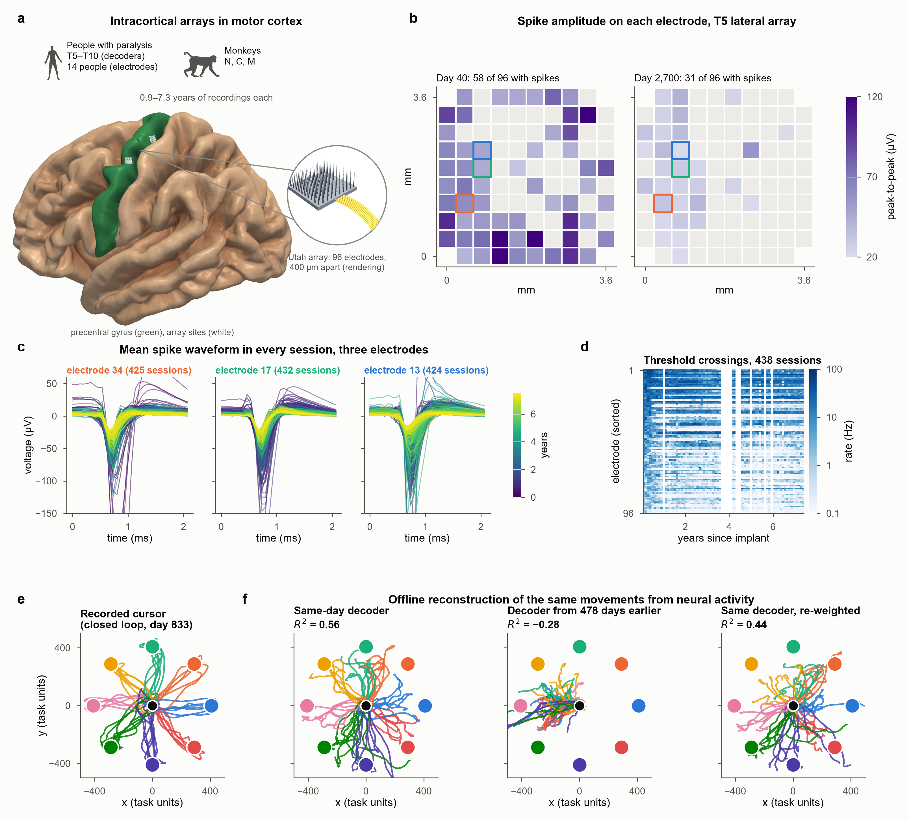

# Decoder decay and its correction over years in intracortical brain–computer interfaces



Code, results and a benchmark for measuring how **intracortical brain–computer interface (iBCI) decoders lose accuracy
over days to years**, and which corrections recover it. One pipeline is applied to public long-term recordings from
**three monkeys and six BrainGate participants** (decoders) and **20 Utah arrays in 14 people** (electrodes), with gaps
of 1 to 480 days between training and test sessions.

**Keywords:** intracortical brain–computer interface, neural decoder, decoder drift, decoder recalibration,
nonstationarity, neural population alignment, Utah array, motor cortex, BrainGate, long-term neural recordings,
benchmark, neural data simulator.

## Main findings

- **Decay differs widely between individuals.** A fixed decoder lost half its accuracy within a day in one participant
  and only after about 200 days in another (mixed model, P = 1e-28).
- **Weak regularization exaggerates decay.** Tuning the ridge penalty on training-day data alone slows measured decay.
- **Label-free alignment adds little beyond per-session normalization**, although an alignment fitted with labels
  shows that better alignments exist (42–85% of the long-gap loss recoverable). Even that ceiling leaves 15–58% of the
  loss, which needs new labels.
- **About 100 labeled trials (a few minutes) restore most accuracy in people.**
- **Most brief electrode silences look like session-to-session fluctuation;** month-long silences are real and often
  reverse.

## What is in this repository

| Path | Contents |
| --- | --- |
| `src/ibci/` | Python package: data loaders, decoders and corrections (`anatomy.py`), statistics, the drift simulator (`sim.py`), the benchmark API (`bench/`) and data paths (`paths.py`). |
| `scripts/` | One script per analysis; `scripts/reproduce.py` runs them all in order. |
| `benchmark/` | Year-scale decoder-transfer benchmark: 1,824 fixed session pairs in 9 individuals, task definition, rules and baselines. See [benchmark/README.md](benchmark/README.md). |
| `results/` | All derived results (tables, JSON summaries, run logs and figures), including earlier and superseded runs in `results/archive/`. See [results/README.md](results/README.md). |
| `docs/` | [REPRODUCE.md](docs/REPRODUCE.md) (step-by-step guide) and [SIMULATOR.md](docs/SIMULATOR.md) (drift simulator). |
| `examples/` | A short example of the simulator on a real session. |
| `tests/` | Unit tests. |

## How to reproduce

The full guide, with data sizes, run times and the script behind every figure and table, is in
**[docs/REPRODUCE.md](docs/REPRODUCE.md)**. In short:

### 1. Install

Python 3.11; the exact package versions are pinned in `requirements.txt`.

```bash
git clone https://github.com/Imtiaj-Sajin/invasive-bci.git
cd invasive-bci
./reproduce.sh setup          # Windows: reproduce.bat setup
```

### 2. Get the data

All datasets are public. The downloads total roughly 100 GB, most of it the BrainGate decoding archives, which
are converted to much smaller files.

```bash
./reproduce.sh data           # downloads the DANDI datasets and prints the two manual Dryad steps
```

By default the data go to `data/` inside the repository. To use another folder, set the environment variable
`IBCI_DATA`, or list one folder per dataset in `data_roots.json` (see `src/ibci/paths.py`).

### 3. Run the analyses and rebuild the results

```bash
./reproduce.sh ladders        # correction ladders for every individual
./reproduce.sh analyses       # tuned decoders, alignment ceiling, controls, recalibration
./reproduce.sh electrodes     # electrode statistics and monitoring
./reproduce.sh simulator      # simulator calibration and validation
./reproduce.sh summaries      # statistics, benchmark baselines and all figures
./reproduce.sh check          # tests and benchmark reproduction check
```

`./reproduce.sh all` runs every stage in order; `./reproduce.sh --list` shows each command first. Each stage can be
run on its own, and `--skip-existing` resumes after an interruption. The results already in `results/` let you rebuild
all summaries and figures with `./reproduce.sh summaries` without downloading any data.

## Benchmark

The benchmark asks how well a decoder trained on one day works on a later day, given 0 to 300 labeled trials from the
new day. Splits, metrics, reference methods and baseline scores are in [benchmark/README.md](benchmark/README.md);
`python scripts/bench_run.py --plugin your_module:your_method` scores a new method.

## Simulator

`ibci.sim` turns a real session into a simulated session days to years later, with parameters calibrated on monkey N.
See [docs/SIMULATOR.md](docs/SIMULATOR.md) and `examples/simulate_drift.py`.

## Data sources

Please cite the original datasets when you use them:

- **LINK** (monkey N), DANDI Archive 001201, CC-BY-4.0: Temmar et al., *Adv. Neural Inf. Process. Syst.* 38 (2025).
- **Long-term reaching recordings** (monkeys C and M), DANDI Archive 000688, CC-BY-4.0: Perich and Miller.
- **BrainGate yield and decoding data**, Dryad doi:10.5061/dryad.x0k6djj1h, CC0: Hahn et al., *Nat. Med.* (2026).
- **MINDFUL closed-loop data**, Dryad doi:10.5061/dryad.n2z34tn5s, CC0: Pun et al., *Commun. Biol.* 7, 1363 (2024).

## Citation

If you use this code, the benchmark or the results, please cite the repository ([CITATION.cff](CITATION.cff)). The
article describing the study is under review; the reference will be added here.

## Licence

MIT. See [LICENSE](LICENSE).
